# SOFTWARE REQUIREMENT SPECIFICATION (SRS)

## GlowWise: Aplikasi Identifikasi Masalah Kulit Wajah, Rekomendasi Kandungan Skincare, dan Jadwal Perawatan Harian Berbasis Jetpack Compose

---

### Informasi Dokumen
* **Nama Proyek:** GlowWise
* **ID Dokumen:** `SRS-GLOWWISE-PAM2026-v1.0`
* **Versi:** 1.0 (Final Draft)
* **Tanggal Rilis:** November 2026
* **Penulis:** Mahasiswa Pengembang PAM 2026
* **Mata Kuliah:** Pengembangan Aplikasi Mobile (PAM) 2026
* **Standar Acuan:** IEEE Std 830-1998

---

### Riwayat Revisi Dokumen

| Tanggal | Versi | Deskripsi Perubahan | Penulis |
| :---: | :---: | :--- | :--- |
| 13/11/2026 | 0.1 | Penyusunan draf awal spesifikasi kebutuhan | Developer PAM |
| 13/11/2026 | 1.0 | Finalisasi kebutuhan fungsional 5 CRUDS, MVVM, JWT, dan skema PostgreSQL | Developer PAM |
| 17/11/2026 | 1.1 | Penyesuaian fitur Scan Wajah berbasis YouCam Skin Analysis API (Perfect Corp), rincian operasional CRUDS 5 entitas, dan sinkronisasi kebutuhan sistem | Developer |

---

## DAFTAR ISI
1. **Introduction (Pendahuluan)**
   - 1.1 Purpose (Tujuan)
   - 1.2 Document Conventions (Konvensi Dokumen)
   - 1.3 Intended Audience and Reading Suggestions (Audiens Sasaran)
   - 1.4 Project Scope (Ruang Lingkup Proyek)
   - 1.5 References (Referensi)
   - 1.6 Acronyms and Abbreviations (Singkatan dan Istilah)
2. **Overall Description (Gambaran Umum Sistem)**
   - 2.1 Product Perspective (Perspektif Produk)
   - 2.2 Product Features (Daftar Fitur Produk)
   - 2.3 User Classes and Characteristics (Kelas Pengguna & Karakteristik)
   - 2.4 Operating Environment (Lingkungan Operasi)
   - 2.5 Design and Implementation Constraints (Batasan Desain & Implementasi)
   - 2.6 User Documentation (Dokumentasi Pengguna)
   - 2.7 Assumptions and Dependencies (Asumsi & Ketergantungan)
3. **System Features (Kebutuhan Fungsional & CRUDS)**
   - 3.1 Modul Otentikasi dan Otorisasi (Authentication & Role-Based Authorization)
   - 3.2 Fitur CRUDS 1: Scan Wajah & Identifikasi Masalah Kulit (Skin Scans)
   - 3.3 Fitur CRUDS 2: Kandungan Bahan Skincare & Conflict Checker (Active Ingredients)
   - 3.4 Fitur CRUDS 3: Katalog Produk Skincare (Products Catalog)
   - 3.5 Fitur CRUDS 4: Jadwal Rutinitas Perawatan Harian (Daily Routines)
   - 3.6 Fitur CRUDS 5: Catatan Perkembangan Kulit (Skin Progress Logs)
   - 3.7 Fitur Penyimpanan Berkas Lokal (Local File Storage PDF)
4. **External Interface Requirements (Kebutuhan Antarmuka Eksternal)**
   - 4.1 User Interfaces (Antarmuka Pengguna)
   - 4.2 Hardware Interfaces (Antarmuka Perangkat Keras)
   - 4.3 Software Interfaces (Antarmuka Perangkat Lunak)
   - 4.4 Communications Interfaces (Antarmuka Komunikasi)
5. **Other Nonfunctional Requirements (Kebutuhan Non-Fungsional Lainnya)**
   - 5.1 Performance Requirements (Kebutuhan Kinerja)
   - 5.2 Safety Requirements (Kebutuhan Keselamatan)
   - 5.3 Security Requirements (Kebutuhan Keamanan)
   - 5.4 Software Quality Attributes (Atribut Kualitas Perangkat Lunak)
6. **Other Requirements: Skema Basis Data PostgreSQL**
   - 6.1 Entity Relationship Diagram (ERD)
   - 6.2 Data Definition Language (DDL) Skema Tabel
7. **Appendix (Lampiran)**
   - Appendix A: Glossary (Glosarium)
   - Appendix B: Use Case Model Description

---

## BAB 1: INTRODUCTION (PENDAHULUAN)

### 1.1 Purpose (Tujuan)
Dokumen *Software Requirement Specification* (SRS) ini bertujuan untuk menetapkan spesifikasi kebutuhan perangkat lunak dalam pengembangan aplikasi **GlowWise (Versi 1.0)**. Tujuan utama aplikasi GlowWise adalah membantu pengguna mengidentifikasi masalah kulit wajah secara objektif melalui fitur pemindaian wajah (*face scan*) yang terintegrasi dengan REST API *YouCam Skin Analysis API (Perfect Corp)*, memperoleh rekomendasi kandungan skincare yang tepat, memvalidasi pantangan kombinasi bahan aktif (*conflict checker*) guna mencegah risiko iritasi kulit, serta mengelola jadwal rutinitas perawatan harian pagi (*AM*) dan malam (*PM*) yang dapat diekspor ke dalam berkas PDF lokal. Secara teknis, pengembangan aplikasi ini mengimplementasikan arsitektur modern Android berbasis 100% Jetpack Compose (Navigator Compose), pola perancangan MVVM, otentikasi JWT multi-role (Admin dan User), serta pengelolaan 5 entitas data utama berfitur CRUDS penuh melalui REST API dan basis data PostgreSQL.

### 1.2 Document Conventions (Konvensi Dokumen)
Dokumen *Software Requirement Specification* (SRS) ini menggunakan konvensi penulisan, tipografi, dan penomoran yang ditentukan oleh pengembang guna mempermudah pemahaman, menjaga konsistensi istilah, serta memastikan ketertelusuran (*traceability*) kebutuhan sistem:

#### 1. Konvensi Tipografi & Format Teks
* **Huruf Miring (*Italics*):**
  - **Istilah Bahasa Asing & Teknis:** Digunakan untuk istilah teknologi informasi, pemrograman mobile, dan arsitektur perangkat lunak (contoh: *framework*, *state management*, *conflict checker*, *client-server*, *payload*, *single source of truth*).
  - **Terminologi Medis & Bahan Aktif:** Digunakan untuk istilah dermatologi dan nama kimiawi/biologi bahan kosmetik (contoh: *Propionibacterium acnes*, *Salicylic Acid*, *stratum corneum*).
  - **Entitas & Kolom Basis Data:** Digunakan saat menyebutkan nama tabel relasional dan atribut dalam narasi (contoh: tabel *users*, entitas *daily_routines*, kolom *access_token*).
* **Huruf Tebal (**Bold**):** Digunakan untuk judul bab, istilah utama, penanda tingkatan prioritas, serta teks yang membutuhkan penekanan khusus.
* **Format Kode (`Monospace`):** Digunakan untuk penulisan penamaan endpoint REST API (contoh: `POST /api/skin-scan`), nama berkas fisik (contoh: `MainActivity.kt`), sintaks kode pemrograman Kotlin, dan kode unik kebutuhan sistem (contoh: `FR-AUTH-01`).
* **Garis Bawah (*Underline*):** Digunakan khusus untuk tautan dokumen atau pranala web (*hyperlink*).

#### 2. Konvensi Kodefikasi Kebutuhan Sistem
Setiap butir kebutuhan sistem diberi kode pengenal unik untuk memudahkan pelacakan pengujian:
* **Kebutuhan Fungsional (*Functional Requirements*):**
  - Format Umum: `FR-[MODUL]-[NOMOR]` (contoh: `FR-AUTH-01`, `FR-AUTH-02`).
  - Format Fitur CRUDS Penuh: `FR-[ENTITAS]-[METODE]`  
    Dengan kode metode:
    - `-C` untuk fungsi *Create* (penambahan data baru).
    - `-R` untuk fungsi *Read* (penampilan dan pembacaan data).
    - `-U` untuk fungsi *Update* (pengubahan dan pembaruan data).
    - `-D` untuk fungsi *Delete* (penghapusan data).
    - `-S` untuk fungsi *Search* (pencarian dan penyaringan data dinamis).
* **Kebutuhan Non-Fungsional (*Non-Functional Requirements*):**
  - Format: `NFR-[KATEGORI]-[NOMOR]`  
    Kategori mencakup: `NFR-PERF` (Kinerja), `NFR-SEC` (Keamanan), `NFR-SAFE` (Keselamatan), dan `NFR-QUAL` (Kualitas/Maintainability).

#### 3. Konvensi Skala Prioritas & Pewarisan (*Priority Inheritance*)
Tingkat kepentingan setiap kebutuhan sistem diklasifikasikan ke dalam tiga tingkatan:
* **Tinggi (*High / Mandatory*):** Kebutuhan fungsional dan arsitektural inti yang menjadi fondasi utama sistem (seperti: 100% Jetpack Compose, arsitektur MVVM, otentikasi JWT, 5 fitur CRUDS penuh, dan basis data terpusat PostgreSQL).
* **Sedang (*Medium*):** Kebutuhan fungsional pendukung operasional yang meningkatkan efisiensi dan pengalaman pengguna.
* **Rendah (*Low*):** Kebutuhan pelengkap estetika antarmuka atau fungsi tambahan yang bersifat opsional.
* **Aturan Pewarisan Prioritas (*Priority Inheritance*):** Secara *default*, seluruh pernyataan kebutuhan detail yang berada di bawah suatu fitur induk mewarisi (*inherit*) tingkat prioritas dari fitur induk tersebut, kecuali dinyatakan secara eksplisit memiliki prioritas berbeda pada tabel rincian kebutuhan.

### 1.3 Intended Audience and Reading Suggestions (Audiens Sasaran)
Dokumen ini ditujukan kepada:
1. **Penguji dan Evaluator Sistem:** Sebagai tolok ukur pengujian dan evaluasi teknis untuk memverifikasi bahwa perangkat lunak yang dibangun selaras dengan spesifikasi kebutuhan yang telah ditetapkan.
2. **Mahasiswa Pengembang (Developer):** Sebagai pedoman arsitektur dan cetak biru pengkodean (*coding reference*) mulai dari *UI Layer*, *ViewModel*, *Repository*, *Network Client* (Retrofit2), hingga *Database Migration (PostgreSQL)*.
3. **Masyarakat Umum / Pengguna Awam (End Users):** Sebagai sumber informasi bagi masyarakat luas atau pengguna umum untuk memahami ruang lingkup fungsi, batasan klinis, serta manfaat aplikasi GlowWise dalam memandu perawatan kesehatan kulit wajah secara mandiri dan aman.

### 1.4 Project Scope (Ruang Lingkup Proyek)
GlowWise adalah aplikasi kesehatan kulit wajah berbasis mobile Android yang berfokus pada pencegahan iritasi kulit dan personalisasi perawatan harian. Aplikasi memfasilitasi identifikasi kondisi kulit melalui pemindaian foto wajah (*face scan*) terhubung ke *YouCam Skin Analysis API (Perfect Corp)*, rekomendasi bahan aktif terkurasi, pendeteksian pantangan kombinasi zat kimia (*conflict checker*), pengaturan jadwal pagi (*AM*) dan malam (*PM*), serta pencatatan jurnal progres kulit mandiri. Aplikasi ini tidak menggantikan tindakan medis operasi dermatologis di rumah sakit, melainkan berfungsi sebagai asisten preventif kesehatan kulit harian.

### 1.5 References (Referensi)
1. Tim Dosen PAM, *Pedoman Project Akhir Pengembangan Aplikasi Mobile 2026*, Program Studi Informatika, 2026.
2. IEEE Computer Society, *IEEE Recommended Practice for Software Requirements Specifications (IEEE Std 830-1998)*, IEEE, 1998.
3. Google Developers, *Guide to App Architecture: Modern Android Architecture with MVVM and StateFlow*, Android Open Source Project, 2025.
4. Google Developers, *Navigation in Jetpack Compose: Multi-Page Routing and Navigation Graph*, Android Open Source Project, 2025.
5. Journal of Clinical and Aesthetic Dermatology, *Cosmetic Active Ingredients Interactions and Skin Barrier Integrity*, 2024.
6. PostgreSQL Global Development Group, *PostgreSQL 16.0 Documentation*, 2024.
7. Perfect Corp, *YouCam AI Skin Analysis API Technical Documentation*, Perfect Corp Enterprise, 2026.

### 1.6 Acronyms and Abbreviations (Singkatan dan Istilah)

Tabel berikut memuat seluruh singkatan teknis, terminologi komputasi, dan istilah medis dermatologi yang digunakan di dalam dokumen ini:

| Singkatan / Istilah | Kepanjangan / Definisi Resmi |
| :--- | :--- |
| AHA / BHA | *Alpha Hydroxy Acid* / *Beta Hydroxy Acid* (Bahan aktif asam untuk eksfoliasi kulit wajah). |
| AM / PM | *Ante Meridiem* (Sesi perawatan pagi hari) / *Post Meridiem* (Sesi perawatan malam hari). |
| ANR | *Application Not Responding* (Kondisi sistem Android saat aplikasi membeku lebih dari 5 detik). |
| API | *Application Programming Interface* (Antarmuka penghubung komunikasi antar komponen perangkat lunak). |
| APK | *Android Package Kit* (Format berkas biner paket instalasi aplikasi mobile Android). |
| BPOM | Badan Pengawas Obat dan Makanan (Lembaga otoritas pengawas standar keamanan kosmetik dan obat di Indonesia). |
| Conflict Checker | Algoritma validasi otomatis untuk mendeteksi kontraindikasi atau pantangan racikan antara dua zat aktif *skincare*. |
| CRUDS | *Create, Read, Update, Delete, Search* (Lima metode dasar pengelolaan data pada sistem informasi). |
| DDL | *Data Definition Language* (Kumpulan perintah SQL untuk membangun skema dan struktur tabel basis data). |
| ERD | *Entity Relationship Diagram* (Diagram pemodelan relasi dan keterhubungan antar entitas data). |
| FPS | *Frames Per Second* (Satuan laju bingkai visual per detik untuk mengukur kelancaran animasi antarmuka). |
| FR | *Functional Requirement* (Pernyataan kodefikasi kebutuhan fungsional sistem perangkat lunak). |
| HTTPS | *Hypertext Transfer Protocol Secure* (Protokol komunikasi jaringan aman yang terenkripsi menggunakan SSL/TLS). |
| JSON | *JavaScript Object Notation* (Format standar pertukaran data berbasis teks yang ringan dan terstruktur). |
| JWT | *JSON Web Token* (Standar token keamanan ringkas untuk otentikasi sesi dan transmisi klaim hak akses pengguna). |
| MVVM | *Model-View-ViewModel* (Pola arsitektur perangkat lunak yang memisahkan logika data, *state*, dan antarmuka tampilan). |
| NFR | *Non-Functional Requirement* (Pernyataan kodefikasi kebutuhan non-fungsional sistem). |
| PDF | *Portable Document Format* (Format dokumen digital independen untuk laporan cetak atau pertukaran berkas). |
| PK / FK | *Primary Key* (Kunci utama unik suatu entitas) / *Foreign Key* (Kunci asing penghubung relasi antar tabel). |
| REST | *Representational State Transfer* (Gaya arsitektur layanan web berbasis protokol HTTP tanpa status / *stateless*). |
| Scoped Storage | Paradigma isolasi sistem berkas Android untuk melindungi privasi berkas pengguna di memori penyimpanan lokal. |
| SPF | *Sun Protection Factor* (Tolak ukur ilmiah proteksi tabir surya terhadap paparan sinar ultraviolet B / UVB). |
| SQL | *Structured Query Language* (Bahasa terstandarisasi untuk mengelola dan memanipulasi data pada basis data relasional). |
| SRS | *Software Requirement Specification* (Dokumen resmi spesifikasi kebutuhan perangkat lunak acuan pengembang). |
| UI / UX | *User Interface* (Desain tampilan visual antarmuka) / *User Experience* (Pengalaman dan kenyamanan pengguna). |
| UML | *Unified Modeling Language* (Bahasa pemodelan visual standar industri untuk perancangan perangkat lunak). |
| YouCam Skin Analysis API | Layanan REST API *cloud* dari Perfect Corp untuk analisis citra foto wajah dan deteksi kondisi klinis dermatologis (sebum, bintik jerawat, kelembaban, dan pori-pori). |

---

## BAB 2: OVERALL DESCRIPTION (GAMBARAN UMUM SISTEM)

### 2.1 Product Perspective (Perspektif Produk)
GlowWise merupakan aplikasi mobile mandiri (*standalone mobile app*) berarsitektur *client-server*. Klien Android (GlowWise) beroperasi di perangkat pengguna, berkomunikasi dengan server *backend* melalui protokol HTTPS/REST API untuk pertukaran data berformat JSON, dan menggunakan basis data relasional **PostgreSQL** yang dihosting secara terpusat. 

Untuk analisis citra wajah yang objektif dan terverifikasi klinis, server *backend* bertindak sebagai jembatan aman (*secure gateway*) yang meneruskan foto wajah (*selfie* atau unggahan galeri) dari aplikasi *mobile* ke layanan **YouCam Skin Analysis API (Perfect Corp)** berbasis *cloud* menggunakan *API Key* privat di sisi server (mencegah kebocoran kredensial dari aplikasi klien). Server *backend* kemudian menerima 28+ skor analitik diagnostik dermatologis (mencakup kadar minyak/*oiliness*, bintik noda/*spots*, kekencangan/*firmness*, lingkaran hitam/*dark circles*, jerawat, dan pori-pori), menyimpannya ke basis data PostgreSQL, lalu mengembalikannya ke aplikasi Android pengguna.

Seluruh data transaksional dan relasional disimpan secara terpusat pada basis data PostgreSQL di sisi server *backend*, sedangkan penyimpanan lokal perangkat dimanfaatkan untuk berkas dokumen cetak (PDF) melalui *Android Scoped Storage*.

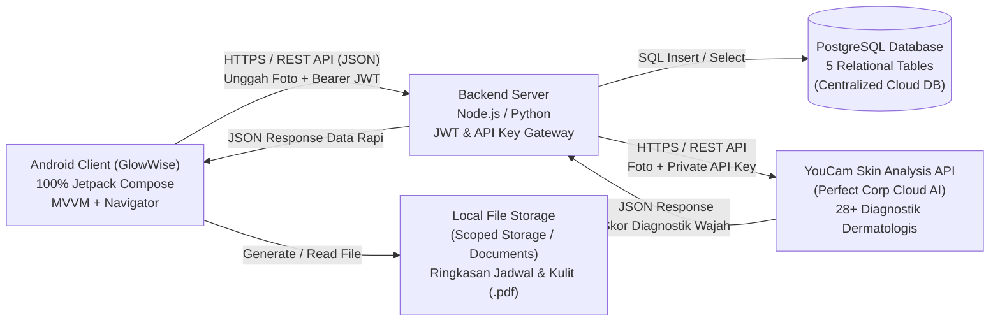

### 2.2 Product Features (Daftar Fitur Produk)
Aplikasi GlowWise memiliki 8 kelompok fitur utama:
1. **Otentikasi Aman (JWT):** Registrasi akun, Login, serta manajemen *Access Token* dan *Refresh Token*.
2. **Otorisasi Berbasis Peran (*Role-based UI*):** Pemisahan hak akses antarmuka antara Admin (Pakar) dan User (Pengguna Umum).
3. **Scan Wajah & Identifikasi Masalah Kulit:** Pengambilan foto *selfie* langsung (kamera) atau *upload* foto wajah dari galeri yang dianalisis oleh **YouCam Skin Analysis API (Perfect Corp)** untuk mendeteksi tipe kulit, kadar minyak (*oiliness*), bintik noda (*spots*), kekencangan (*firmness*), lingkaran hitam mata (*dark circles*), dan jerawat.
4. **Manajemen Bahan Aktif & Conflict Checker:** Master data zat aktif kosmetik dan algoritma validasi otomatis untuk mendeteksi pantangan racikan bahan kimia berbahaya.
5. **Katalog Produk Skincare:** Direktori produk terkurasi yang dikaitkan dengan kandungan bahan aktif dan rekomendasi tipe kulit.
6. **Jadwal Rutinitas Harian AM/PM:** Penyusunan protokol tahapan perawatan pagi (*AM*) dan malam hari (*PM*) dengan daftar centang (*checklist*) harian.
7. **Catatan Perkembangan Kulit:** Jurnal harian (*logbook*) untuk memantau perubahan kondisi wajah dan mencatat riwayat reaksi alergi.
8. **Penyimpanan Berkas Lokal (File Storage):** Ekspor dan pembacaan *offline* berkas PDF ringkasan perawatan wajah ke penyimpanan internal perangkat.

### 2.3 User Classes and Characteristics (Kelas Pengguna)
1. **User (Pengguna Umum / Pasien Perawatan):**
   - **Karakteristik:** Masyarakat umum, pelajar, atau mahasiswa yang ingin merawat kulit wajah dengan aman.
   - **Hak Akses:** Menjalankan identifikasi masalah kulit, melihat katalog produk, menyusun jadwal rutinitas, mencatat progres kulit, dan mengunduh berkas PDF.
2. **Admin (Pakar Dermatologi / Administrator Sistem):**
   - **Karakteristik:** Pengelola data yang memiliki pemahaman tentang formulasi kosmetik dan keamanan zat kimia.
   - **Hak Akses:** Hak penuh mengelola master data masalah kulit, bahan aktif, aturan pantangan kombinasi zat aktif, dan katalog produk.

### 2.4 Operating Environment (Lingkungan Operasi)
- **Perangkat Klien:** Smartphone Android dengan sistem operasi minimal Android 8.0 (Oreo / API Level 26) hingga Android 15+.
- **Perangkat Keras Klien:** RAM minimal 2 GB, layar sentuh resolusi minimal 720x1280 piksel, penyimpanan kosong minimal 100 MB.
- **Server Backend:** Runtime Node.js v18+ / Python 3.10+ di atas sistem operasi Linux / *Cloud Server*.
- **Basis Data Server:** PostgreSQL v14 ke atas.

### 2.5 Design and Implementation Constraints (Batasan Desain & Implementasi)
Batasan arsitektural dan teknologi yang membatasi ruang lingkup perancangan serta implementasi sistem GlowWise meliputi:

1. **Batasan Bahasa & Framework Antarmuka:**  
   Pengembangan antarmuka pengguna (*UI Layer*) wajib 100% menggunakan **Jetpack Compose (Material Design 3)** secara deklaratif tanpa memanfaatkan tata letak konvensional XML Layout. Pengelolaan navigasi multi-halaman dibatasi hanya menggunakan pustaka resmi **Navigator Compose** (`androidx.navigation:navigation-compose`).

2. **Batasan Pola Arsitektur Perangkat Lunak:**  
   Aplikasi wajib menerapkan arsitektur **MVVM** (*Model-View-ViewModel*) dengan pemisahan tegas antara logika data (*Repository*), manajemen status antarmuka (*State Management* berbasis `StateFlow`), dan tampilan antarmuka (*Compose UI*).

3. **Batasan Pengelolaan Basis Data & Jaringan:**  
   Seluruh persistensi data transaksional utama dikelola secara terpusat pada basis data relasional **PostgreSQL** dan diakses melalui protokol **REST API JSON (HTTPS)**, tanpa memanfaatkan basis data lokal Room.

4. **Batasan Antarmuka Eksternal (Layanan Cloud):**  
   Fitur identifikasi masalah kulit wajah mengandalkan integrasi dengan layanan *cloud* **YouCam Skin Analysis API (Perfect Corp)** yang dijembatani melalui server *backend*. Klien Android mengirimkan citra foto ke *backend*, lalu server *backend* melakukan *request* ke YouCam API menggunakan *Private API Key* yang tersimpan aman pada variabel lingkungan (*environment variables*) server. Skor diagnostik (kadar minyak/*oiliness*, bintik noda/*spots*, kekencangan/*firmness*, lingkaran hitam/*dark circles*, dan jerawat) diuraikan secara asinkronus, disimpan ke PostgreSQL, lalu dikembalikan ke aplikasi klien.

5. **Batasan Keamanan & Standar Otentikasi:**  
   Otentikasi dan otorisasi sesi wajib menggunakan standar token **JWT** berpasangan: *Access Token* (masa aktif singkat) dan *Refresh Token* (masa aktif panjang), serta penerapan algoritma *hashing* *bcrypt* untuk pengamanan kata sandi pengguna di sisi basis data.

6. **Batasan Penyimpanan Berkas Lokal:**  
   Penyimpanan berkas lokal pada memori smartphone dibatasi khusus untuk berkas dokumen cetak laporan jadwal dan kondisi kulit (format PDF) menggunakan pustaka bawaan `PdfDocument` dan wajib mematuhi paradigma isolasi sistem berkas *Android Scoped Storage*.

### 2.6 User Documentation (Dokumentasi Pengguna)
- Tersedia buku panduan singkat (*Onboarding Screen* dan menu *Bantuan*) di dalam aplikasi.
- Tersedia berkas `README.md` pada repositori proyek yang memuat dokumentasi arsitektur, panduan konfigurasi API, dan panduan instalasi aplikasi.

### 2.7 Assumptions and Dependencies (Asumsi & Ketergantungan)

#### 1. Asumsi (*Assumptions*):
1. **Konektivitas Jaringan:** Pengguna diasumsikan memiliki perangkat dengan koneksi internet yang stabil (Wi-Fi atau data seluler) untuk sinkronisasi data dengan server basis data dan eksekusi layanan API.
2. **Ketersediaan Perangkat Keras:** Smartphone pengguna diasumsikan memiliki modul kamera depan (*selfie camera*) yang berfungsi dengan baik untuk mengambil foto wajah pengguna.
3. **Pemberian Izin Aplikasi (*Runtime Permissions*):** Pengguna diasumsikan menyetujui izin akses kamera dan media penyimpanan (*storage permission*) saat pertama kali menjalankan fitur pemindaian wajah dan penyimpanan dokumen PDF.
4. **Keabsahan Data Medis:** Seluruh data acuan bahan aktif dan aturan pantangan kombinasi zat kimia diasumsikan telah divalidasi berdasarkan literatur dermatologi terpercaya.

#### 2. Ketergantungan (*Dependencies*):
1. **Ketergantungan Layanan Cloud (YouCam Skin Analysis API):** Keberhasilan pemindaian wajah bergantung pada ketersediaan operasional (*uptime*) dan stabilitas endpoint REST API YouCam Skin Analysis API (Perfect Corp) dalam memproses citra dan mengembalikan data JSON diagnostik kulit.
2. **Ketergantungan Server Backend & Basis Data:** Kelancaran pertukaran data aplikasi bergantung penuh pada ketersediaan server REST API dan basis data PostgreSQL yang dihosting secara terpusat.
3. **Ketergantungan Sistem Operasi Android:** Aplikasi bergantung pada ketersediaan API Android level 26 ke atas untuk menjalankan fungsi *Android Scoped Storage* dan enkripsi kredensial.

---

## BAB 3: SYSTEM FEATURES (KEBUTUHAN FUNGSIONAL & CRUDS)

Bab ini menguraikan seluruh kebutuhan fungsional perangkat lunak GlowWise yang diorganisasikan berdasarkan fitur sistem utama (layanan inti yang disediakan oleh aplikasi). Setiap fitur sistem dijabarkan mencakup deskripsi fungsi, tingkat prioritas implementasi, urutan stimulus dan respon aksi beserta diagram alir sistem (*flowchart* per fitur) dan diagram aktivitas (*activity diagram* per fitur dengan format 3 jalur: *Actor*, *Aplikasi*, *Database*), serta daftar kodefikasi kebutuhan fungsional terinci termasuk operasi pengelolaan data CRUDS (*Create, Read, Update, Delete, Search*) untuk 5 entitas relasional utama.

### Use Case Diagram & Daftar Fitur Sistem (List Feature)
Diagram Use Case berikut memetakan keterhubungan fungsional antara aktor pengguna (**User** dan **Admin**) dengan seluruh fungsi layanan fitur sistem (*list feature*) yang disediakan oleh aplikasi GlowWise:

#### Kode PlantUML Use Case Diagram:
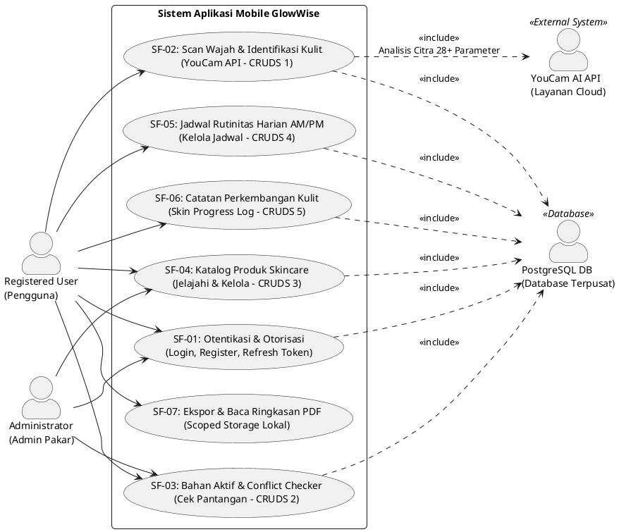

#### Diagram Visual (Mermaid Preview):
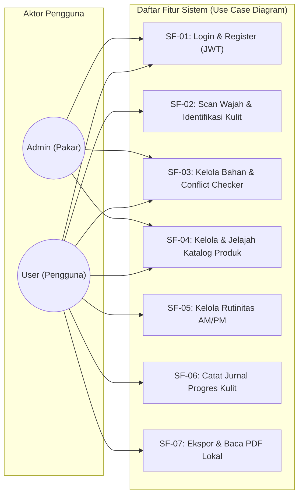

| Kode Fitur | Nama Fitur Sistem | Nama Use Case | Aktor Utama | Deskripsi Singkat Layanan |
| :--- | :--- | :--- | :--- | :--- |
| **SF-01** | Otentikasi & Otorisasi | Login, Register & Refresh Token | User, Admin | Pengamanan sesi dengan JWT berpasangan dan pengalihan UI berbasis peran. |
| **SF-02** | Scan Wajah (CRUDS 1) | Identifikasi Masalah Kulit | User | Pemindaian wajah via YouCam API dan perekaman skor diagnostik desimal. |
| **SF-03** | Bahan Aktif (CRUDS 2) | Cek Pantangan (*Conflict Checker*) & Master Bahan | User, Admin | Pengelolaan data zat aktif kosmetik dan validasi otomatis kontraindikasi bahan. |
| **SF-04** | Katalog Produk (CRUDS 3)| Kelola & Jelajahi Katalog Produk | User, Admin | Direktori produk skincare terhubung dengan relasi bahan aktif target. |
| **SF-05** | Jadwal Rutinitas (CRUDS 4)| Kelola Protokol AM/PM | User | Penyusunan tahapan perawatan pagi/malam dengan *checklist* kepatuhan harian. |
| **SF-06** | Progres Kulit (CRUDS 5) | Catat Jurnal Transformasi Kulit | User | *Logbook* kronologis perkembangan kondisi wajah dan reaksi alergi. |
| **SF-07** | Berkas Lokal PDF | Ekspor & Baca Ringkasan PDF | User | Pembuatan dokumen cetak jadwal dan pembacaan *offline* via *Scoped Storage*. |

---

### 3.1 Modul Otentikasi dan Otorisasi (Authentication & Role-Based Authorization)

#### 3.1.1 Description and Priority
* **Deskripsi Fitur:** Modul ini berfungsi mengamankan akses akun pengguna melalui pendaftaran akun baru (*Register*), verifikasi kredensial saat masuk (*Login*), penerbitan pasangan token keamanan JWT (*Access Token* berdurasi 15 menit dan *Refresh Token* berdurasi 7 hari), penyimpanan sesi terenkripsi pada *EncryptedSharedPreferences*, serta pemisahan hak akses tampilan antarmuka (*Role-based UI*) antara Admin Pakar dan Pengguna Umum.
* **Prioritas:** **Tinggi (*High / Mandatory*)** — Menjadi prasyarat mutlak sistem sebelum pengguna dapat mengakses fitur personalisasi dan data medis kulit.

#### 3.1.2 Stimulus/Response Sequences
**A. Urutan Tindakan Pengguna & Respon Sistem:**
1. Pengguna menginput email dan password, lalu menekan tombol "Masuk" -> Klien Android mengirim HTTP POST `/api/auth/login` -> Server memverifikasi hash bcrypt di PostgreSQL -> Server merespons `access_token` dan `refresh_token` -> Aplikasi menyimpan token pada *Encrypted DataStore* dan mengarahkan ke halaman sesuai role.
2. Access Token kedaluwarsa (HTTP 401) -> OkHttp Authenticator secara otomatis memanggil endpoint `/api/auth/refresh` -> Server menerbitkan token baru tanpa membuat pengguna logout paksa.

**B. Alur Sistem (Flowchart Fitur 1):**

*Kode PlantUML Flowchart:*
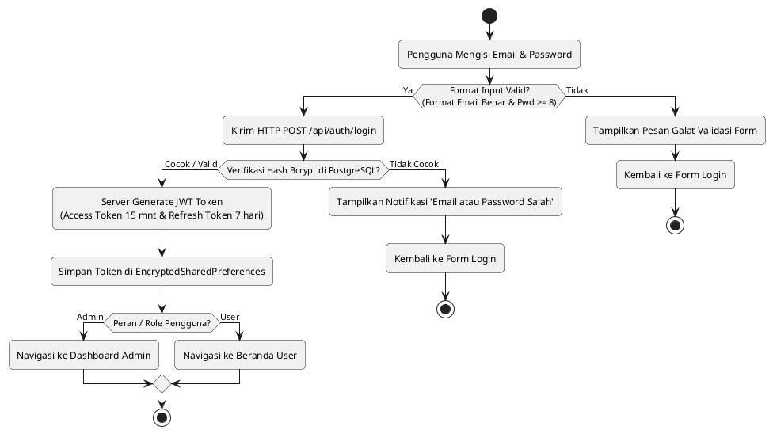

*Diagram Visual (Mermaid Preview):*
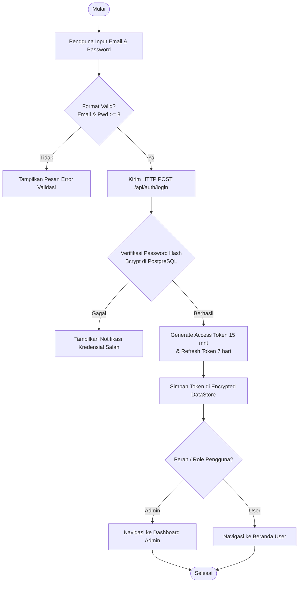

**C. Diagram Aktivitas (Activity Sequence Diagram - 3 Line: Actor, Aplikasi, Database):**

*Kode PlantUML Activity Diagram (3 Lines):*
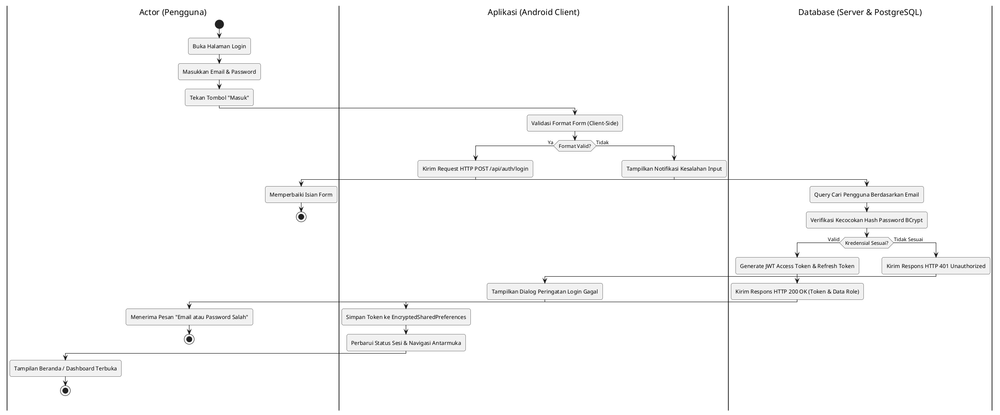

*Diagram Visual (Mermaid Preview):*
```mermaid
sequenceDiagram
    autonumber
    actor Actor as Pengguna (Actor)
    participant App as Aplikasi (Android Client)
    participant DB as Database (Server & PostgreSQL)

    Actor->>App: Masukkan email & password, klik "Masuk"
    App->>DB: Request autentikasi (HTTP POST /api/auth/login)
    DB->>DB: Verifikasi hash bcrypt & terbitkan token JWT
    alt Kredensial Valid
        DB-->>App: Respons HTTP 200 OK (access_token, refresh_token, role)
        App->>App: Simpan token di Encrypted DataStore
        App-->>Actor: Arahkan ke dashboard sesuai role (Admin / User)
    else Kredensial Tidak Cocok
        DB-->>App: Respons HTTP 401 Unauthorized
        App-->>Actor: Tampilkan dialog peringatan login gagal
    end
```

#### 3.1.3 Functional Requirements
* **FR-AUTH-01:** Sistem menyediakan antarmuka pendaftaran akun (*Register*) dengan memvalidasi format email dan kata sandi minimal 8 karakter yang dienkripsi menggunakan algoritma *hashing* BCrypt sebelum disimpan ke basis data PostgreSQL.  
  * *Respon Galat:* Jika format email tidak valid atau panjang kata sandi kurang dari 8 karakter, sistem menampilkan pesan galat spesifik pada antarmuka dan memblokir pengiriman formulir.
* **FR-AUTH-02:** Sistem memverifikasi kredensial pengguna saat proses masuk (*Login*) dan menerbitkan pasangan token keamanan JWT (*Access Token* berdurasi 15 menit dan *Refresh Token* berdurasi 7 hari) jika data akun valid.  
  * *Respon Galat:* Jika email atau kata sandi tidak cocok dengan data pada tabel `users`, sistem mengembalikan kode HTTP 401 *Unauthorized* dan menampilkan notifikasi: *"Email atau kata sandi salah"*.
* **FR-AUTH-03:** Sistem menyimpan *Access Token* dan *Refresh Token* secara aman dan persisten pada media penyimpanan lokal klien menggunakan *EncryptedSharedPreferences*.  
  * *Respon Galat:* Jika penyimpanan lokal gagal diakses atau berkas terkorupsi, sistem mengosongkan status sesi dan mengarahkan kembali ke layar *Login*.
* **FR-AUTH-04:** Sistem menerapkan kendali akses berbasis peran (*Role-Based Access Control* / RBAC) yang secara otomatis menampilkan menu navigasi *Admin* bagi administrator dan menu *User* bagi pengguna umum.  
  * *Respon Galat:* Jika pengguna dengan peran *user* mencoba mengakses rute atau *endpoint* khusus admin, server menolak permintaan dengan kode HTTP 403 (*Forbidden*) dan menampilkan pesan pembatasan akses.
* **FR-AUTH-05:** Sistem menjalankan penyegaran token otomatis (*Automatic Token Refresh*) via *interceptor OkHttp* ketika *Access Token* kedaluwarsa tanpa menghentikan alur kerja pengguna secara paksa.  
  * *Respon Galat:* Jika masa berlaku *Refresh Token* juga telah kedaluwarsa (> 7 hari), sistem menghapus seluruh sesi lokal dan mengarahkan pengguna ke halaman *Login* dengan notifikasi: *"Sesi Anda telah berakhir, silakan masuk kembali"*.
* **FR-AUTH-06:** Sistem menyediakan fungsionalitas keluar akun (*Logout*) yang mencabut sesi aktif, menghapus pasangan token JWT dari penyimpanan lokal, dan mengembalikan antarmuka ke layar *Login*.  
  * *Respon Galat:* Jika koneksi jaringan internet terputus saat proses *logout* dieksekusi, sistem tetap menghapus token lokal secara luring (*offline*) demi menjaga privasi dan keamanan data pengguna.

---

### 3.2 Fitur CRUDS 1: Scan Wajah & Identifikasi Masalah Kulit (Skin Scans)

#### 3.2.1 Description and Priority
* **Deskripsi Fitur:** Fitur pemindaian citra wajah pengguna melalui kamera langsung (*selfie*) maupun unggahan galeri smartphone yang terintegrasi secara daring dengan REST API **YouCam Skin Analysis API (Perfect Corp)** untuk mendeteksi 28+ diagnostik klinis pada 16+ parameter masalah kulit (skor desimal *oiliness*, *spots*, *firmness*, *dark circles*, dan deteksi jerawat) secara otomatis dan objektif serta menyimpannya ke tabel `skin_scans`.
* **Prioritas:** **Tinggi (*High / Mandatory*)** — Nilai guna utama dan pembeda inti aplikasi GlowWise dalam mengidentifikasi masalah kulit wajah pengguna sesuai tema kesehatan.

#### 3.2.2 Stimulus/Response Sequences
**A. Urutan Tindakan Pengguna & Respon Sistem:**
1. Pengguna mengambil foto *selfie* langsung (kamera) atau mengunggah (*upload*) foto wajah dari galeri -> Klien Android mengirimkan berkas citra melalui HTTP POST `/api/skin-scan` (*Multipart Form-Data*) dengan *Header* `Authorization: Bearer <access_token>` ke server *backend* -> Server *backend* meneruskan foto tersebut beserta kredensial *Private API Key* rahasia ke endpoint resmi **YouCam Skin Analysis API (Perfect Corp)** -> Server AI YouCam menganalisis citra wajah dan mengembalikan respon data JSON berupa 28+ parameter diagnostik (skor *oiliness*, *spots*, *dark circles*, *firmness*, dll.) -> Server *backend* mem-parsing data tersebut, menyimpan rekam riwayat ke tabel PostgreSQL `skin_scans`, lalu meneruskan data JSON yang bersih ke klien Android -> Komponen *ViewModel* klien memperbarui status `StateFlow` dan antarmuka Jetpack Compose langsung menampilkan kartu diagnosa klinis beserta rekomendasi bahan aktif pendukung.

**B. Alur Sistem (Flowchart Fitur 2):**

*Kode PlantUML Flowchart:*
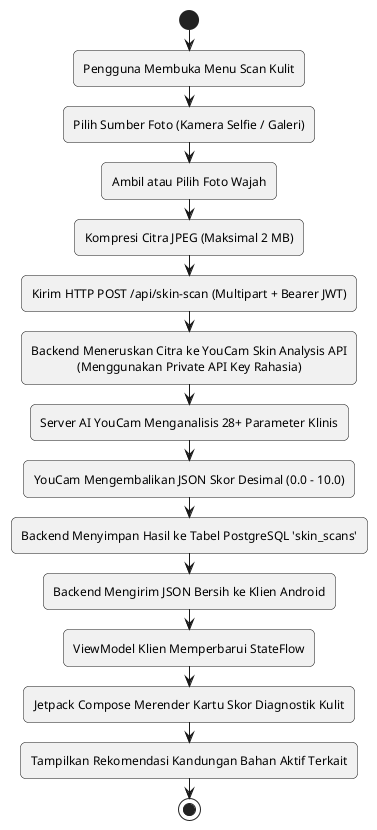

*Diagram Visual (Mermaid Preview):*
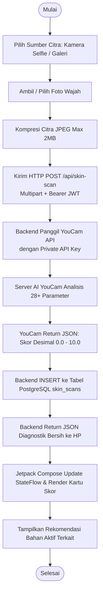

**C. Diagram Aktivitas (Activity Sequence Diagram - 3 Line: Actor, Aplikasi, Database):**

*Kode PlantUML Activity Diagram (3 Lines):*
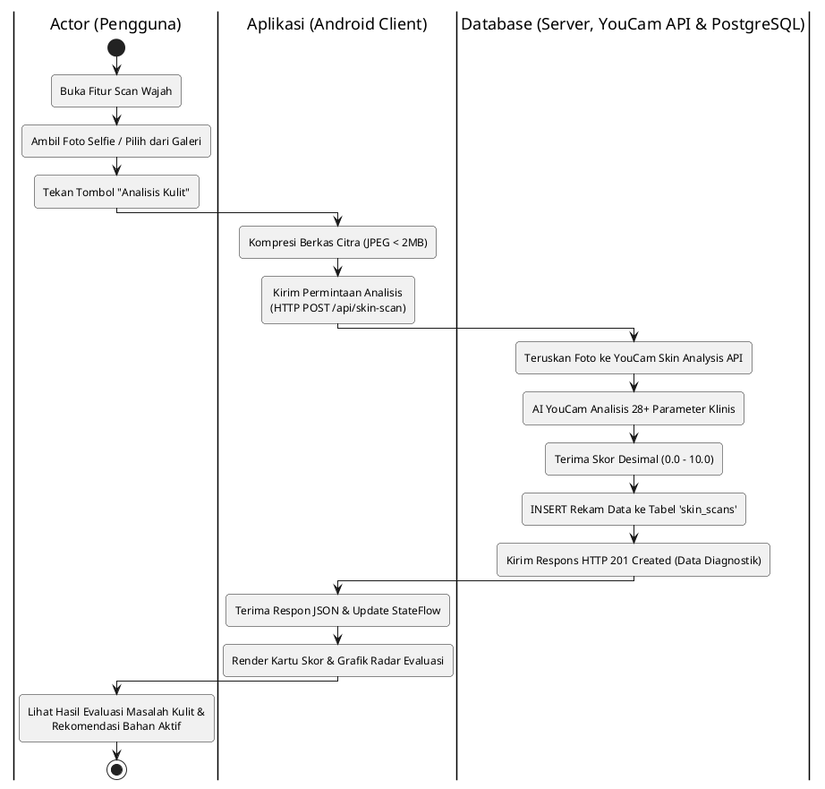

*Diagram Visual (Mermaid Preview):*
```mermaid
sequenceDiagram
    autonumber
    actor Actor as Pengguna (Actor)
    participant App as Aplikasi (Android Client)
    participant DB as Database (Server, API & PostgreSQL)

    Actor->>App: Buka menu Scan, ambil foto selfie / upload galeri
    App->>DB: Kirim foto wajah (HTTP POST /api/skin-scan)
    DB->>DB: Analisis via YouCam API & INSERT hasil ke skin_scans
    DB-->>App: Respons HTTP 201 Created (Data skor diagnostik lengkap)
    App->>App: Update StateFlow & render kartu hasil evaluasi
    App-->>Actor: Tampilkan kartu visual diagnosa & anjuran zat aktif
```

#### 3.2.3 Functional Requirements
* **FR-SCAN-C (Create):** Pengguna mengambil foto *selfie* atau mengunggah citra wajah dari galeri, sistem meneruskan citra ke *YouCam Skin Analysis API*, menerima skor diagnostik kuantitatif (desimal 0.0 - 10.0), dan menyimpannya ke tabel `skin_scans`.  
  * *Respon Galat:* Jika citra wajah buram, tidak terdeteksi wajah, atau koneksi ke YouCam API terputus (HTTP 502/504), sistem menampilkan peringatan: *"Wajah tidak terdeteksi jelas, silakan ulangi foto dengan pencahayaan cukup"*.
* **FR-SCAN-R (Read):** Pengguna membaca riwayat kartu hasil *scan* wajah, rincian skor keparahan kondisi kulit, grafik radar parameter klinis, dan daftar rekomendasi bahan aktif pendukung.  
  * *Respon Galat:* Jika riwayat scan belum tersedia atau gagal dimuat dari server (HTTP 500), antarmuka menampilkan *Empty State* dengan ilustrasi ramah dan tombol muat ulang (*Retry*).
* **FR-SCAN-U (Update):** Pengguna memperbarui catatan keluhan subjektif (misal: "kulit terasa perih setelah terpapar matahari") atau memperbarui status penanganan masalah kulit pada rekaman hasil scan terdahulu.  
  * *Respon Galat:* Jika input pembaruan melebihi batas 500 karakter atau request gagal disimpan ke PostgreSQL, sistem mempertahankan teks di form dan memunculkan *Snackbar* notifikasi galat.
* **FR-SCAN-D (Delete):** Pengguna menghapus riwayat rekaman *scan* wajah tertentu dari basis data PostgreSQL secara permanen.  
  * *Respon Galat:* Sebelum penghapusan dieksekusi, sistem menampilkan dialog konfirmasi keamanan (*Confirm Dialog*). Jika server gagal menghapus, item data tetap ditampilkan di antarmuka.
* **FR-SCAN-S (Search):** Pengguna mencari dan menyaring riwayat hasil *scan* kulit berdasarkan rentang tanggal evaluasi atau parameter dominan (misal: "Jerawat", "Minyak").  
  * *Respon Galat:* Jika kriteria pencarian tidak menemukan kecocokan data riwayat, sistem menampilkan pesan: *"Tidak ada data hasil scan yang cocok dengan filter yang dipilih"*.

---

### 3.3 Fitur CRUDS 2: Kandungan Bahan Skincare & Conflict Checker (Active Ingredients)

#### 3.3.1 Description and Priority
* **Deskripsi Fitur:** Modul direktori bahan aktif kosmetik dan algoritma validasi otomatis (*Conflict Checker*) untuk mendeteksi kontraindikasi atau pantangan racikan bahan aktif berbahaya jika diaplikasikan secara bersamaan (contoh: Retinol vs konsentrasi tinggi AHA/BHA) guna mencegah risiko iritasi kimiawi pada kulit pengguna.
* **Prioritas:** **Tinggi (*High / Mandatory*)** — Fitur keselamatan utama pengguna (*user safety*) untuk mencegah kerusakan sawar pelindung kulit (*skin barrier*).

#### 3.3.2 Stimulus/Response Sequences
**A. Urutan Tindakan Pengguna & Respon Sistem:**
1. Pengguna memilih produk untuk dimasukkan ke jadwal rutinitas -> Aplikasi mengirim request pengecekan ke `/api/ingredients/check-conflict` -> Backend server mengekstrak aturan pantangan kombinasi dari tabel `skincare_ingredients` di PostgreSQL -> Backend mengevaluasi matriks kompatibilitas kimiawi -> Jika ada bahaya iritasi, sistem menampilkan dialog peringatan visual dan membatalkan penambahan secara aman.

**B. Alur Sistem (Flowchart Fitur 3):**
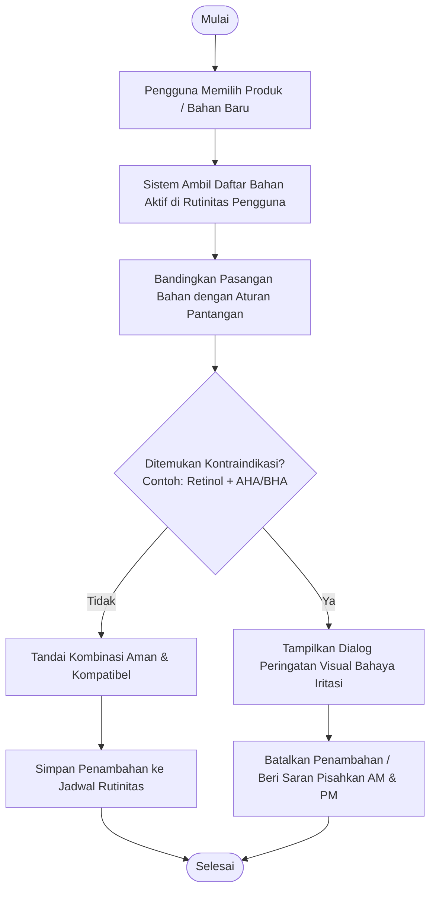

**C. Diagram Aktivitas (Activity Sequence Diagram - 3 Line: Actor, Aplikasi, Database):**
```mermaid
sequenceDiagram
    autonumber
    actor Actor as Pengguna (Actor)
    participant App as Aplikasi (Android Client)
    participant DB as Database (Server & PostgreSQL)

    Actor->>App: Pilih produk untuk ditambahkan ke rutinitas
    App->>DB: Cek kompatibilitas bahan (HTTP POST /api/ingredients/check-conflict)
    DB->>DB: Eksekusi matriks pantangan dari skincare_ingredients
    alt Ditemukan Pantangan Berbahaya
        DB-->>App: Respons HTTP 200 (conflict: true, message: bahaya iritasi)
        App-->>Actor: Tampilkan popup peringatan merah & opsi ganti sesi
    else Kombinasi Aman
        DB-->>App: Respons HTTP 200 (conflict: false, message: kombinasi aman)
        App-->>Actor: Tampilkan konfirmasi sukses & masukkan ke jadwal
    end
```

#### 3.3.3 Functional Requirements
* **FR-INGR-C (Create):** Admin menambahkan entitas data bahan aktif baru lengkap dengan khasiat klinis, target tipe kulit, dan aturan pantangan kombinasi ke tabel `skincare_ingredients`.  
  * *Respon Galat:* Jika nama bahan kimia aktif sudah ada di basis data (duplikasi nama) atau kolom mandatori kosong, sistem memunculkan pesan validasi: *"Nama bahan aktif telah terdaftar"*.
* **FR-INGR-R (Read):** Pengguna dan Admin membaca daftar bahan aktif kosmetik, khasiat dermatologis, serta panduan keamanan waktu pemakaian (Pagi/Malam).  
  * *Respon Galat:* Jika data master bahan gagal diambil dari PostgreSQL, aplikasi menampilkan indikator kesalahan jaringan dengan opsi penyegaran manual (*Pull-to-refresh*).
* **FR-INGR-U (Update):** Admin memperbarui matriks pantangan racikan kimiawi, tingkat konsentrasi aman, atau deskripsi manfaat bahan aktif.  
  * *Respon Galat:* Jika terjadi benturan pembaruan (*concurrency error*) atau kegagalan koneksi database, sistem membatalkan perubahan dan menampilkan peringatan galat.
* **FR-INGR-D (Delete):** Admin menghapus atau menonaktifkan data bahan aktif kosmetik yang ditarik peredarannya atau dilarang oleh otoritas BPOM.  
  * *Respon Galat:* Jika bahan aktif masih berelasi sebagai *Foreign Key* pada produk di `skincare_products`, sistem menolak penghapusan (*RESTRICT*) dan meminta admin merevisi produk terkait terlebih dahulu.
* **FR-INGR-S (Search):** Pengguna mencari bahan aktif berdasarkan nama zat kimia (misal: "Niacinamide") atau menyaring berdasarkan keluhan target (misal: "Jerawat").  
  * *Respon Galat:* Jika kata kunci tidak ditemukan, sistem menampilkan pesan: *"Bahan aktif tidak ditemukan dalam basis data kosmetik"*.
* **FR-INGR-V (Validation):** Algoritma *Conflict Checker* memvalidasi secara otomatis kompatibilitas antar-zat aktif ketika pengguna menambahkan produk ke rutinitas harian.  
  * *Respon Galat:* Jika terdeteksi kontraindikasi kimia berbahaya (contoh: Retinol + AHA/BHA tinggi), sistem memunculkan dialog peringatan tegas (*Amber Warning*) dan membatalkan penambahan demi keamanan kulit.

---

### 3.4 Fitur CRUDS 3: Katalog Produk Skincare (Products Catalog)

#### 3.4.1 Description and Priority
* **Deskripsi Fitur:** Direktori produk perawatan kulit terkurasi yang dikaitkan dengan kandungan bahan aktif melalui integritas referensial relasional, mencakup kategori pembersih, toner, serum, pelembab, dan tabir surya yang dapat dicari dan difilter berdasarkan tipe kulit.
* **Prioritas:** **Sedang (*Medium*)** — Berperan sebagai modul pendukung operasional untuk membantu pengguna menemukan produk yang sesuai dengan hasil rekomendasi analisis kulit.

#### 3.4.2 Stimulus/Response Sequences
**A. Urutan Tindakan Pengguna & Respon Sistem:**
1. Pengguna membuka tab Katalog dan memilih filter kategori produk -> Aplikasi mengirimkan query pencarian ke backend API -> Backend mengeksekusi SQL SELECT berelasi ke PostgreSQL dan mengembalikan daftar produk JSON -> Compose UI merender kartu produk dengan gambar, merk, kategori, dan lencana bahan aktif.

**B. Alur Sistem (Flowchart Fitur 4):**
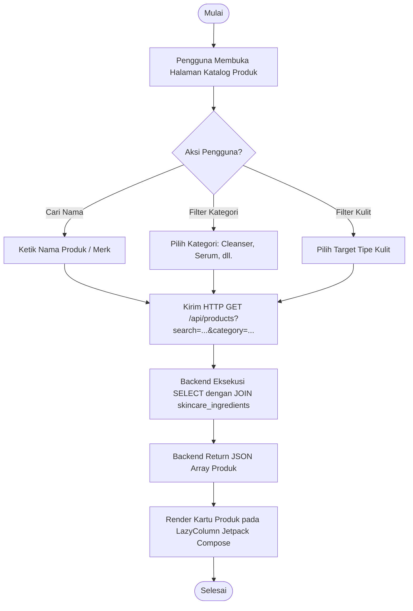

**C. Diagram Aktivitas (Activity Sequence Diagram - 3 Line: Actor, Aplikasi, Database):**
```mermaid
sequenceDiagram
    autonumber
    actor Actor as Pengguna (Actor)
    participant App as Aplikasi (Android Client)
    participant DB as Database (Server & PostgreSQL)

    Actor->>App: Buka menu Katalog, ketik filter / kategori produk
    App->>DB: Cari produk (HTTP GET /api/products?category=...&search=...)
    DB->>DB: Eksekusi SQL SELECT dengan JOIN skincare_ingredients
    DB-->>App: Respons HTTP 200 OK (JSON array daftar produk)
    App->>App: Render daftar produk via LazyColumn dengan tag bahan
    Actor->>App: Klik salah satu kartu produk untuk melihat detail
    App-->>Actor: Tampilkan halaman detail & tombol "Tambah ke Rutinitas"
```

#### 3.4.3 Functional Requirements
* **FR-PROD-C (Create):** Admin menginput produk baru lengkap dengan merk, nama produk, kategori pemakaian, foto, dan relasi bahan aktif utama ke tabel `skincare_products`.  
  * *Respon Galat:* Jika berkas foto melebihi batas 2MB atau bahan aktif yang direlasikan tidak valid, sistem menolak penyimpanan dan meminta verifikasi isian formulir.
* **FR-PROD-R (Read):** Pengguna menjelajahi katalog produk yang terhubung dengan rekomendasi tipe kulit dan bahan aktif secara responsif via `LazyColumn`.  
  * *Respon Galat:* Jika koneksi internet terputus saat *scroll* katalog, sistem menampilkan *toast* koneksi terputus dan menampilkan data yang telah ter-cache di memori aplikasi.
* **FR-PROD-U (Update):** Admin memperbarui spesifikasi produk, foto, merk, atau merubah keterkaitan relasi bahan aktif.  
  * *Respon Galat:* Jika request pembaruan gagal diproses di server (HTTP 500), perubahan antarmuka dibatalkan dan nilai semula dipulihkan.
* **FR-PROD-D (Delete):** Admin menghapus data produk yang ditarik dari pasaran dari tabel `skincare_products`.  
  * *Respon Galat:* Jika produk sedang digunakan aktif di jadwal pengguna (`daily_routines`), sistem menampilkan peringatan konfirmasi dampak sebelum penghapusan diizinkan.
* **FR-PROD-S (Search):** Pengguna mencari dan menyaring produk berdasarkan merk, nama produk, kategori kosmetik (Cleanser, Toner, Serum), atau zat aktif.  
  * *Respon Galat:* Jika produk yang dicari tidak ditemukan, antarmuka menampilkan pesan: *"Produk yang Anda cari belum tersedia dalam katalog"*.

---

### 3.5 Fitur CRUDS 4: Jadwal Rutinitas Perawatan Harian (Daily Routines)

#### 3.5.1 Description and Priority
* **Deskripsi Fitur:** Manajemen urutan tahapan dan daftar centang (*checklist*) perawatan wajah harian pagi (*AM Routine*) dan malam hari (*PM Routine*) untuk memantau kedisiplinan dan kepatuhan perawatan kulit harian pengguna.
* **Prioritas:** **Sedang (*Medium*)** — Berfungsi meningkatkan retensi pengguna dan membangun kebiasaan pemakaian produk yang konsisten dan teratur.

#### 3.5.2 Stimulus/Response Sequences
**A. Urutan Tindakan Pengguna & Respon Sistem:**
1. Pengguna membuka tab Rutinitas Harian dan mencentang tahapan perawatan yang selesai -> Aplikasi Android mengirimkan permintaan HTTP PATCH ke backend API -> Backend memperbarui kolom `status_selesai` pada tabel `daily_routines` di PostgreSQL -> StateFlow di Android merespons pembaruan, centang hijau aktif, dan progress bar kepatuhan bertambah.

**B. Alur Sistem (Flowchart Fitur 5):**
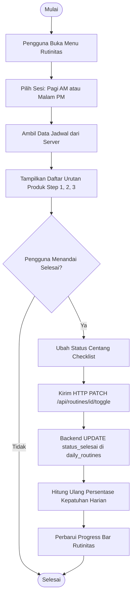

**C. Diagram Aktivitas (Activity Sequence Diagram - 3 Line: Actor, Aplikasi, Database):**
```mermaid
sequenceDiagram
    autonumber
    actor Actor as Pengguna (Actor)
    participant App as Aplikasi (Android Client)
    participant DB as Database (Server & PostgreSQL)

    Actor->>App: Buka tab Rutinitas Harian, centang langkah perawatan
    App->>DB: Update checklist (HTTP PATCH /api/routines/{id}/toggle)
    DB->>DB: UPDATE status_selesai pada tabel daily_routines
    DB-->>App: Respons HTTP 200 OK (status tersimpan di PostgreSQL)
    App->>App: Mutasi StateFlow, centang aktif & progress bar bertambah
    App-->>Actor: Tampilkan indikator visual langkah selesai
```

#### 3.5.3 Functional Requirements
* **FR-ROUT-C (Create):** Pengguna menambahkan produk perawatan kulit ke jadwal harian pagi (*AM Routine*) atau malam (*PM Routine*) pada tabel `daily_routines`.  
  * *Respon Galat:* Jika produk sudah pernah dimasukkan ke sesi waktu yang sama, sistem menampilkan notifikasi: *"Produk ini sudah ada di dalam jadwal rutinitas Anda"*.
* **FR-ROUT-R (Read):** Pengguna melihat urutan tahapan pemakaian produk (Step 1, Step 2, Step 3) dan status centang penyelesaian harian (*checklist*).  
  * *Respon Galat:* Jika jadwal rutinitas kosong, antarmuka menyajikan petunjuk awal (*Empty State*) dan tombol jalan pintas *"Tambah Produk dari Rekomendasi"*.
* **FR-ROUT-U (Update):** Pengguna menandai status selesai (*checked/unchecked*) atau menyusun ulang urutan langkah pemakaian produk harian.  
  * *Respon Galat:* Jika request pembaruan centang gagal disimpan ke server (HTTP PATCH gagal), status centang dikembalikan ke kondisi sebelumnya dan dimunculkan pesan galat.
* **FR-ROUT-D (Delete):** Pengguna menghapus suatu produk dari daftar jadwal rutinitas harian jika produk sudah habis atau diganti.  
  * *Respon Galat:* Sebelum menghapus, sistem meminta konfirmasi pengguna. Jika server gagal memproses, data tetap dipertahankan di antarmuka.
* **FR-ROUT-S (Search):** Pengguna menyaring dan melihat jadwal rutinitas berdasarkan sesi waktu spesifik (*AM* atau *PM*) atau hari tertentu.  
  * *Respon Galat:* Jika tidak ada jadwal pada sesi yang dipilih, sistem menampilkan status informasi: *"Belum ada jadwal perawatan pada sesi ini"*.

---

### 3.6 Fitur CRUDS 5: Catatan Perkembangan Kulit (Skin Progress Logs)

#### 3.6.1 Description and Priority
* **Deskripsi Fitur:** Jurnal rekam jejak mandiri (*logbook*) kronologis untuk mendokumentasikan transformasi kesehatan kulit wajah, mencatat reaksi alergi atau iritasi produk, serta melampirkan foto perkembangan visual dari waktu ke waktu.
* **Prioritas:** **Sedang (*Medium*)** — Berfungsi sebagai sarana evaluasi efektivitas produk skincare bagi pengguna secara berkala.

#### 3.6.2 Stimulus/Response Sequences
**A. Urutan Tindakan Pengguna & Respon Sistem:**
1. Pengguna mengisi catatan perkembangan kulit harian dan keluhan reaksi alergi -> Aplikasi mengirim data jurnal ke backend melalui HTTP POST `/api/progress-logs` -> Backend menyimpan entri jurnal baru ke tabel `skin_progress_logs` di PostgreSQL -> Aplikasi memperbarui tampilan linimasa jurnal dan menampilkan notifikasi sukses simpan.

**B. Alur Sistem (Flowchart Fitur 6):**
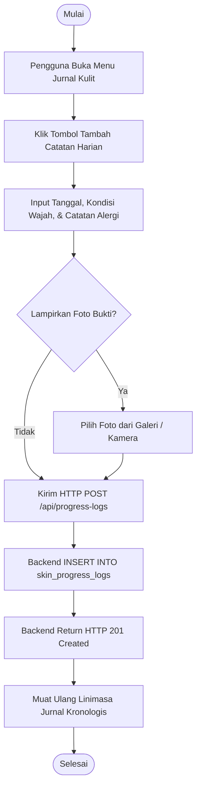

**C. Diagram Aktivitas (Activity Sequence Diagram - 3 Line: Actor, Aplikasi, Database):**
```mermaid
sequenceDiagram
    autonumber
    actor Actor as Pengguna (Actor)
    participant App as Aplikasi (Android Client)
    participant DB as Database (Server & PostgreSQL)

    Actor->>App: Input deskripsi kondisi kulit, catatan alergi & foto
    App->>DB: Kirim catatan harian (HTTP POST /api/progress-logs)
    DB->>DB: INSERT data log ke tabel skin_progress_logs
    DB-->>App: Respons HTTP 201 Created (Log tersimpan)
    App->>App: Refresh kartu linimasa jurnal perkembangan
    App-->>Actor: Tampilkan notifikasi "Catatan harian berhasil disimpan"
```

#### 3.6.3 Functional Requirements
* **FR-LOG-C (Create):** Pengguna mencatat entri jurnal perkembangan kulit baru, deskripsi kondisi kulit, tingkat iritasi, catatan reaksi alergi, dan melampirkan foto bukti ke tabel `skin_progress_logs`.  
  * *Respon Galat:* Jika formulir dikirim tanpa mengisi tanggal atau berkas foto rusak/tidak didukung, sistem menolak pengiriman dan menampilkan tanda peringatan merah pada kolom input.
* **FR-LOG-R (Read):** Pengguna melihat riwayat linimasa (*timeline*) jurnal transformasi kulit secara kronologis mulai dari tanggal pencatatan paling baru.  
  * *Respon Galat:* Jika catatan log gagal diambil dari server, sistem menampilkan pesan galat jaringan dan tombol pemuatan ulang (*Retry*).
* **FR-LOG-U (Update):** Pengguna memperbarui deskripsi observasi perkembangan kulit atau menambahkan rincian reaksi iritasi produk yang baru muncul.  
  * *Respon Galat:* Jika koneksi terputus saat menyimpan pembaruan, sistem menyimpan draf secara sementara di memori aplikasi dan menginfokan pengguna.
* **FR-LOG-D (Delete):** Pengguna menghapus entri catatan log harian yang salah input dari tabel `skin_progress_logs`.  
  * *Respon Galat:* Sistem meminta konfirmasi penghapusan. Jika penghapusan gagal di server, sistem memunculkan *Snackbar*: *"Gagal menghapus entri catatan"*.
* **FR-LOG-S (Search):** Pengguna mencari dan memfilter catatan perkembangan berdasarkan kata kunci keluhan alergi atau rentang bulan.  
  * *Respon Galat:* Jika pencarian tidak membuahkan hasil, sistem menampilkan pesan: *"Tidak ada catatan perkembangan yang sesuai dengan pencarian"*.

---

### 3.7 Fitur Penyimpanan Berkas Lokal (Local File Storage PDF)

#### 3.7.1 Description and Priority
* **Deskripsi Fitur:** Pembuatan dokumen ringkasan jadwal rutinitas dan riwayat evaluasi kulit dalam format berkas PDF (*Portable Document Format*) menggunakan pustaka bawaan `PdfDocument` yang disimpan pada memori internal perangkat (*Android Scoped Storage*) dan dapat dibuka serta dibaca kembali secara luring (*offline*).
* **Prioritas:** **Tinggi (*High / Mandatory*)** — Menjadi pemenuhan wajib rubrik CPMK mata kuliah PAM 2026 untuk aspek manipulasi dan penyimpanan berkas lokal Android (*File Storage*).

#### 3.7.2 Stimulus/Response Sequences
**A. Urutan Tindakan Pengguna & Respon Sistem:**
1. Pengguna menekan tombol "Ekspor Dokumen PDF" pada menu ringkasan perawatan -> Aplikasi Android menggambar data profil dan tabel jadwal ke kanvas `PdfDocument` -> Berkas PDF disimpan ke folder `Documents` lokal melalui Android Scoped Storage -> Pengguna menekan tombol "Buka PDF" dan aplikasi membuka file secara *offline* melalui PDF Viewer internal.

**B. Alur Sistem (Flowchart Fitur 7):**
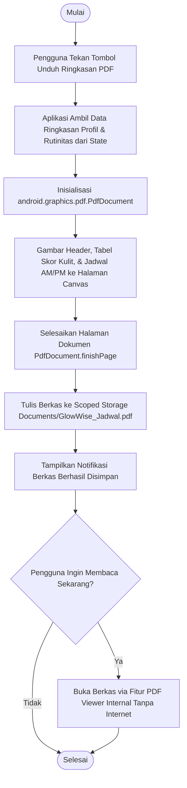

**C. Diagram Aktivitas (Activity Sequence Diagram - 3 Line: Actor, Aplikasi, Database):**
```mermaid
sequenceDiagram
    autonumber
    actor Actor as Pengguna (Actor)
    participant App as Aplikasi (Android Client)
    participant DB as Database (Scoped Storage Lokal)

    Actor->>App: Klik tombol "Ekspor Dokumen PDF" pada ringkasan
    App->>App: Susun data profil & render tabel kanvas PdfDocument
    App->>DB: Tulis berkas GlowWise_Jadwal_[Nama].pdf ke Scoped Storage
    DB-->>App: File stream selesai disimpan di folder Documents
    App-->>Actor: Tampilkan notifikasi sukses & tombol "Buka PDF"
    Actor->>App: Klik tombol "Buka PDF"
    App-->>Actor: Render lembaran PDF secara offline via In-App Viewer
```

#### 3.7.3 Functional Requirements
* **FR-FILE-01 (Generate & Save):** Sistem secara mandiri membuat berkas dokumen PDF digital bernama `GlowWise_Jadwal_[Nama].pdf` yang memuat ringkasan diagnosa kulit, daftar bahan aktif, dan jadwal rutinitas AM/PM ke memori perangkat melalui mekanisme *Android Scoped Storage*.  
  * *Respon Galat:* Jika memori internal perangkat penuh (*Insufficient Storage*) atau penulisan berkas gagal, sistem membatalkan proses dan menampilkan dialog notifikasi galat ke pengguna.
* **FR-FILE-02 (Read & View):** Sistem menyediakan fitur pembacaan (*PDF Viewer*) lokal di dalam aplikasi untuk membuka dan membaca berkas PDF tersebut secara *offline* tanpa memerlukan koneksi internet.  
  * *Respon Galat:* Jika berkas PDF yang ingin dibaca terhapus di luar aplikasi atau rusak (*corrupted*), sistem menampilkan pesan: *"Berkas PDF tidak ditemukan atau rusak, silakan unduh ulang dokumen"*.

---

## BAB 4: EXTERNAL INTERFACE REQUIREMENTS

### 4.1 User Interfaces (Antarmuka Pengguna)
- **Penerapan Penuh:** 100% menggunakan pustaka deklaratif **Jetpack Compose (Material 3)**.
- **Desain Responsif:** Mendukung orientasi vertikal (*portrait*) untuk berbagai rasio layar Android (16:9, 18:9, 20:9).
- **Palet Warna:** Warna bertema kesehatan dan dermatologi modern:
  - *Primary:* Teal Medis (`#00897B`)
  - *Secondary:* Soft Cyan (`#80CBC4`)
  - *Background:* Pure White & Light Gray (`#F8F9FA`)
  - *Accent & Warning:* Amber/Rose Coral (`#FF8A80`) untuk penanda pantangan bahan kimia (*conflict alert*).
- **Navigasi:** Navigasi multi-halaman berbasis `NavHost` dan `NavController` dengan *Bottom Navigation Bar* untuk User dan *Action Drawer* untuk Admin.

### 4.2 Hardware Interfaces (Antarmuka Perangkat Keras)
- **Layar Sentuh:** Menerima input sentuhan, gestur geser (*swipe-to-dismiss*), dan klik tombol.
- **Penyimpanan Perangkat:** Mengakses memori internal perangkat (*Scoped Storage*) untuk menulis dan membaca berkas dokumen PDF.
- **Kamera & Galeri Smartphone:** Mengakses kamera perangkat dan galeri media melalui API `rememberLauncherForActivityResult` di Jetpack Compose untuk memotret atau memilih foto wajah pada fitur pemindaian kulit (*face scan*) serta foto bukti jurnal perkembangan.

### 4.3 Software Interfaces (Antarmuka Perangkat Lunak)
- **Jaringan & HTTP Client:** `Retrofit2` (versi 2.9+) dan `OkHttp3` (versi 4.10+) untuk komunikasi RESTful API berbasis JSON.
- **Layanan Cloud Skin Analysis (YouCam Skin Analysis API):** Antarmuka REST API eksternal dari Perfect Corp (`https://yce.perfectcorp.com/id/ai-api/products/skin-analysis-api`) yang menerima unggahan berkas foto wajah (*multipart/form-data*) dan mengembalikan respon JSON diagnostik klinis (28+ diagnostik mencakup skor *oiliness*, *spots*, *firmness*, *dark circles*, dan deteksi jerawat).
- **Data Serialization:** `Kotlinx Serialization` atau `Gson Converter` untuk serialisasi/deserialisasi JSON ke Kotlin *Data Class*.
- **Pemuat Citra (Image Loading):** Pustaka `Coil Compose` (`io.coil-kt:coil-compose`) untuk merender foto produk dan foto wajah secara asinkronus ke dalam komponen Compose.
- **Penyimpanan Sesi Kredensial:** `EncryptedSharedPreferences` atau `Jetpack DataStore Preferences` untuk menyimpan JWT *Access Token* dan *Refresh Token* secara aman.
- **Basis Data Server:** PostgreSQL Database 14+ terhubung dengan *backend* REST API (Node.js / Python FastAPI).

### 4.4 Communications Interfaces (Antarmuka Komunikasi)
- **Protokol:** Komunikasi aman melalui HTTPS (Port 443).
- **Format Pertukaran Data:** JSON (*JavaScript Object Notation*).
- **Header Keamanan:** `Authorization: Bearer <access_token>` pada setiap permintaan data yang terproteksi.
- **Mekanisme Refresh Token:** *Interceptor* OkHttp otomatis menangani kode status HTTP 401 (*Unauthorized*) dengan memanggil endpoint `/api/auth/refresh` secara transparan.

---

## BAB 5: OTHER NONFUNCTIONAL REQUIREMENTS

### 5.1 Performance Requirements (Kebutuhan Kinerja)
- `NFR-PERF-01`: Waktu respon aplikasi dalam melakukan request dan parsing data JSON dari REST API tidak melebihi 2 detik pada jaringan 4G/WiFi normal.
- `NFR-PERF-02`: Antarmuka Jetpack Compose harus menjaga *framerate* stabil pada 60 FPS untuk rendering animasi dan *scrolling* daftar `LazyColumn`.
- `NFR-PERF-03`: Ukuran file APK hasil rilis maksimal 25 MB.

### 5.2 Safety Requirements (Kebutuhan Keselamatan)
- `NFR-SAFE-01`: Fitur *Conflict Checker* harus memberikan peringatan visual tegas sebelum pengguna menggabungkan dua produk yang memiliki zat aktif berbahaya jika dipakai bersamaan, guna mencegah iritasi kimiawi pada kulit.
- `NFR-SAFE-02`: Berkas PDF yang dihasilkan diisolasi pada direktori aplikasi yang aman untuk mencegah korupsi data.

### 5.3 Security Requirements (Kebutuhan Keamanan)
- `NFR-SEC-01`: Kata sandi pengguna wajib di-hash menggunakan algoritma *bcrypt* dengan *salt round* minimal 10 sebelum disimpan ke basis data PostgreSQL.
- `NFR-SEC-02`: Token otentikasi menggunakan standar JWT dengan masa aktif *Access Token* 15 menit dan *Refresh Token* 7 hari.
- `NFR-SEC-03`: Hak akses peran (*role-based authorization*) diverifikasi ganda: di sisi antarmuka klien Compose dan di sisi middleware server *backend*.

### 5.4 Software Quality Attributes (Atribut Kualitas Perangkat Lunak)
- **Usability:** Antarmuka dirancang intuitif sehingga pengguna baru dapat menyelesaikan alur identifikasi kulit dalam waktu kurang dari 3 menit tanpa buku petunjuk panjang.
- **Reliability:** Aplikasi harus bebas dari *bug* fatal (*crash* atau *Application Not Responding / ANR*) selama pengoperasian sistem dan mampu menangani kegagalan koneksi jaringan secara anggun (*graceful error handling*).
- **Maintainability:** Pemisahan kode yang tegas antara *UI View*, *ViewModel*, *Repository*, dan *Data Source* sesuai arsitektur MVVM mempermudah pemeliharaan dan pengujian unit (*Unit Testing*).

---

## BAB 6: OTHER REQUIREMENTS: KEBUTUHAN BASIS DATA POSTGRESQL

Seluruh data transaksional sistem dikelola secara terpusat pada basis data relasional **PostgreSQL** dengan 5 entitas utama yang memiliki field dinamis dan integritas referensial *Foreign Key*. Pengelolaan basis data sepenuhnya dilakukan di lingkungan *cloud/server* dan diakses oleh aplikasi Android melalui protokol HTTPS REST API.

> **Catatan:** Diagram visual pemodelan data **Entity-Relationship Diagram (ERD) / Relasi Antar Tabel (RAT)** disajikan secara lengkap pada bagian **Appendix B (Lampiran B: Model Analisis)** sesuai standar dokumentasi IEEE Std 830-1998.

### 6.1 Deskripsi Entitas Relasional Utama
Sistem GlowWise mengimplementasikan 5 entitas data relasional inti yang mendukung kebutuhan fungsional dan operasional CRUDS:
1. **`users`**: Menyimpan identitas akun, kredensial hash kata sandi (*Bcrypt*), tipe kulit awal, dan peran otorisasi (`admin` atau `user`).
2. **`skin_scans` (Entitas 1)**: Menyimpan rekaman riwayat pemindaian wajah dari *YouCam Skin Analysis API*, URL citra foto, dan nilai skor diagnostik desimal (*oiliness*, *spots*, *firmness*, *dark circles*, dan *jerawat*).
3. **`skincare_ingredients` (Entitas 2)**: Master data zat aktif kosmetik, target jenis kulit, khasiat klinis, aturan sesi pemakaian (Pagi/Malam), dan teks aturan pantangan kombinasi (*Conflict Checker*).
4. **`skincare_products` (Entitas 3)**: Katalog produk perawatan kulit yang terikat dengan relasi kunci asing `ingredient_id` ke tabel bahan aktif.
5. **`daily_routines` (Entitas 4)**: Tabel transaksional penjadwalan rutinitas harian yang menghubungkan pengguna (`user_id`) dengan produk skincare (`product_id`), sesi waktu (AM/PM), urutan langkah, dan status penyelesaian (*checklist*).
6. **`skin_progress_logs` (Entitas 5)**: Jurnal linimasa mandiri pengguna untuk mendokumentasikan progres perubahan fisik kulit dan reaksi alergi harian.

### 6.2 Data Definition Language (DDL) Skema PostgreSQL

```sql
-- 1. Tabel Pengguna (Users)
CREATE TABLE users (
    id SERIAL PRIMARY KEY,
    nama VARCHAR(100) NOT NULL,
    email VARCHAR(100) UNIQUE NOT NULL,
    password_hash VARCHAR(255) NOT NULL,
    jenis_kulit VARCHAR(50) DEFAULT 'Normal',
    role VARCHAR(20) NOT NULL CHECK (role IN ('admin', 'user')),
    created_at TIMESTAMP DEFAULT CURRENT_TIMESTAMP
);

-- 2. Tabel Hasil Scan & Analisis Kulit (Skin Scans - Entitas 1)
-- Terintegrasi dengan YouCam Skin Analysis API (skor diagnostik skala desimal 0.0 - 10.0)
CREATE TABLE skin_scans (
    id SERIAL PRIMARY KEY,
    user_id INT REFERENCES users(id) ON DELETE CASCADE,
    foto_scan_url TEXT NOT NULL,
    jenis_kulit_terdeteksi VARCHAR(50) NOT NULL,
    skor_minyak NUMERIC(3, 1) NOT NULL,
    skor_spots NUMERIC(3, 1) NOT NULL,
    skor_dark_circles NUMERIC(3, 1) NOT NULL,
    skor_firmness NUMERIC(3, 1) NOT NULL,
    skor_jerawat INT NOT NULL DEFAULT 0,
    catatan_keluhan TEXT,
    created_at TIMESTAMP DEFAULT CURRENT_TIMESTAMP
);

-- 3. Tabel Kandungan Bahan Aktif Skincare (Ingredients - Entitas 2)
CREATE TABLE skincare_ingredients (
    id SERIAL PRIMARY KEY,
    nama_bahan VARCHAR(100) NOT NULL,
    jenis_kulit_target VARCHAR(50) NOT NULL,
    fungsi_utama TEXT NOT NULL,
    waktu_pakai VARCHAR(20) NOT NULL CHECK (waktu_pakai IN ('Pagi', 'Malam', 'Keduanya')),
    pantangan_kombinasi TEXT NOT NULL
);

-- 4. Tabel Katalog Produk Skincare (Products - Entitas 3)
CREATE TABLE skincare_products (
    id SERIAL PRIMARY KEY,
    ingredient_id INT REFERENCES skincare_ingredients(id) ON DELETE SET NULL,
    nama_produk VARCHAR(150) NOT NULL,
    merk VARCHAR(100) NOT NULL,
    kategori VARCHAR(50) NOT NULL,
    foto_url TEXT
);

-- 5. Tabel Jadwal Rutinitas Harian (Daily Routines - Entitas 4)
CREATE TABLE daily_routines (
    id SERIAL PRIMARY KEY,
    user_id INT REFERENCES users(id) ON DELETE CASCADE,
    product_id INT REFERENCES skincare_products(id) ON DELETE CASCADE,
    waktu_rutinitas VARCHAR(10) NOT NULL CHECK (waktu_rutinitas IN ('AM', 'PM')),
    urutan_langkah INT NOT NULL,
    status_selesai BOOLEAN DEFAULT FALSE,
    hari VARCHAR(20) NOT NULL
);

-- 6. Tabel Catatan Perkembangan Kulit (Progress Logs - Entitas 5)
CREATE TABLE skin_progress_logs (
    id SERIAL PRIMARY KEY,
    user_id INT REFERENCES users(id) ON DELETE CASCADE,
    tgl_catat DATE NOT NULL,
    kondisi_wajah VARCHAR(100) NOT NULL,
    catatan_alergi TEXT,
    foto_bukti_lokal TEXT
);
```

---

## BAB 7: APPENDIX (LAMPIRAN)

### Appendix A: Glossary (Glosarium)
- **Active Ingredients (Zat Aktif):** Bahan kimia yang telah teruji klinis memiliki efektivitas untuk merawat atau mengubah struktur kulit (misal: *Salicylic Acid*, *Retinol*, *Niacinamide*).
- **Skin Barrier:** Lapisan pelindung fisik paling luar pada stratum korneum yang menjaga kadar air dan melindungi tubuh dari toksin lingkungan.
- **Conflict Checker:** Algoritma logika validasi yang memeriksa kompatibilitas kimia antara dua atau lebih bahan aktif untuk mendeteksi kontraindikasi pemakaian.
- **AM / PM Routine:** Tata urutan penggunaan produk perawatan wajah pada pagi hari (*Ante Meridiem*) yang berfokus pada perlindungan (sunscreen/antioksidan) dan malam hari (*Post Meridiem*) yang berfokus pada regenerasi sel dan hidrasi.
- **Scoped Storage:** Paradigma isolasi sistem berkas pada Android 10+ di mana aplikasi hanya memiliki akses langsung ke direktori aplikasinya sendiri demi menjaga privasi pengguna.

### Appendix B: Analysis Models (Model Analisis Basis Data: ERD & RAT)

Bagian ini memuat pemodelan analisis basis data yang mencakup pemodelan konseptual (**Entity Relationship Diagram / ERD**) dan pemodelan fisikal relasional (**Relasi Antar Tabel / RAT**) basis data PostgreSQL GlowWise:

#### 1. ERD (Entity Relationship Diagram - Konseptual Data)
Diagram ERD menggambarkan entitas data bisnis, atribut yang menyusunnya, serta derajat keterhubungan (*cardinality*) logis antar entitas:

```mermaid
erDiagram
    USERS ||--o{ SKIN_SCANS : "melakukan"
    USERS ||--o{ DAILY_ROUTINES : "memiliki"
    USERS ||--o{ SKIN_PROGRESS_LOGS : "mencatat"
    SKINCARE_INGREDIENTS ||--o{ SKINCARE_PRODUCTS : "terkandung_dalam"
    SKINCARE_PRODUCTS ||--o{ DAILY_ROUTINES : "dijadwalkan_pada"

    USERS {
        int id PK
        string nama
        string email UK
        string password_hash
        string jenis_kulit
        string role
        timestamp created_at
    }

    SKIN_SCANS {
        int id PK
        int user_id FK
        string foto_scan_url
        string jenis_kulit_terdeteksi
        float skor_minyak
        float skor_spots
        float skor_dark_circles
        float skor_firmness
        int skor_jerawat
        text catatan_keluhan
        timestamp created_at
    }

    SKINCARE_INGREDIENTS {
        int id PK
        string nama_bahan
        string jenis_kulit_target
        text fungsi_utama
        string waktu_pakai
        text pantangan_kombinasi
    }

    SKINCARE_PRODUCTS {
        int id PK
        int ingredient_id FK
        string nama_produk
        string merk
        string kategori
        string foto_url
    }

    DAILY_ROUTINES {
        int id PK
        int user_id FK
        int product_id FK
        string waktu_rutinitas
        int urutan_langkah
        boolean status_selesai
        string hari
    }

    SKIN_PROGRESS_LOGS {
        int id PK
        int user_id FK
        date tgl_catat
        string kondisi_wajah
        text catatan_alergi
        string foto_bukti_lokal
    }
```

---

#### 2. RAT (Relasi Antar Tabel - Skema Fisikal Basis Data)
Diagram dan matriks Relasi Antar Tabel (RAT) mendefinisikan implementasi fisik penyimpanan PostgreSQL dengan penegasan *Primary Key* (PK), *Foreign Key* (FK), kardinalitas satu-ke-banyak (1:N), serta aturan integritas referensial:

```mermaid
classDiagram
    direction LR

    class USERS {
        +PK id: SERIAL
        email: VARCHAR(100)
        password_hash: VARCHAR(255)
        role: VARCHAR(20)
    }

    class SKIN_SCANS {
        +PK id: SERIAL
        +FK user_id: INT
        foto_scan_url: TEXT
        skor_minyak: NUMERIC(3,1)
        skor_spots: NUMERIC(3,1)
    }

    class SKINCARE_INGREDIENTS {
        +PK id: SERIAL
        nama_bahan: VARCHAR(100)
        pantangan_kombinasi: TEXT
    }

    class SKINCARE_PRODUCTS {
        +PK id: SERIAL
        +FK ingredient_id: INT
        nama_produk: VARCHAR(150)
        kategori: VARCHAR(50)
    }

    class DAILY_ROUTINES {
        +PK id: SERIAL
        +FK user_id: INT
        +FK product_id: INT
        waktu_rutinitas: VARCHAR(10)
        status_selesai: BOOLEAN
    }

    class SKIN_PROGRESS_LOGS {
        +PK id: SERIAL
        +FK user_id: INT
        tgl_catat: DATE
        kondisi_wajah: VARCHAR(100)
    }

    USERS "1" --> "0..*" SKIN_SCANS : CASCADE
    USERS "1" --> "0..*" DAILY_ROUTINES : CASCADE
    USERS "1" --> "0..*" SKIN_PROGRESS_LOGS : CASCADE
    SKINCARE_INGREDIENTS "1" --> "0..*" SKINCARE_PRODUCTS : SET NULL
    SKINCARE_PRODUCTS "1" --> "0..*" DAILY_ROUTINES : CASCADE
```

**Matriks Keterhubungan Relasi Antar Tabel (RAT):**

| Entitas Asal (Parent) | Kunci Utama (PK) | Entitas Tujuan (Child) | Kunci Asing (FK) | Kardinalitas | Aturan Integritas | Keterangan Relasi |
| :--- | :--- | :--- | :--- | :---: | :--- | :--- |
| `users` | `users.id` | `skin_scans` | `skin_scans.user_id` | 1 : N | `ON DELETE CASCADE` | Satu pengguna dapat memiliki banyak rekaman hasil scan wajah. |
| `users` | `users.id` | `daily_routines` | `daily_routines.user_id` | 1 : N | `ON DELETE CASCADE` | Satu pengguna dapat menyusun banyak jadwal tahapan rutinitas. |
| `users` | `users.id` | `skin_progress_logs` | `skin_progress_logs.user_id` | 1 : N | `ON DELETE CASCADE` | Satu pengguna dapat mencatat banyak entri jurnal progres kulit. |
| `skincare_ingredients` | `skincare_ingredients.id` | `skincare_products` | `skincare_products.ingredient_id` | 1 : N | `ON DELETE SET NULL` | Satu bahan aktif dapat terkandung dalam beberapa produk kosmetik. |
| `skincare_products` | `skincare_products.id` | `daily_routines` | `daily_routines.product_id` | 1 : N | `ON DELETE CASCADE` | Satu produk perawatan dapat dijadwalkan pada rutinitas AM atau PM. |

### Appendix C: Issues List (Daftar Isu & Mitigasi Risiko)
1. **Risiko Latensi Pemrosesan Citra Cloud:**
   - *Isu:* Pengiriman citra beresolusi tinggi ke YouCam API berpotensi membutuhkan waktu respon lebih dari 3 detik jika koneksi lambat.
   - *Mitigasi:* Klien Android melakukan kompresi citra JPEG (maksimal lebar 1080px dan ukuran berkas < 1.5 MB) sebelum transmisi *multipart* dilakukan.
2. **Keterbatasan Kuota Panggilan API Eksternal:**
   - *Isu:* Pengguna yang melakukan pemindaian berulang kali dalam jeda waktu singkat dapat menghabiskan kuota *API Key*.
   - *Mitigasi:* Server *backend* menerapkan *rate limiting* (maksimal 3 panggilan scan per pengguna per hari) dan menyimpan *cache* hasil scan terakhir di PostgreSQL.
